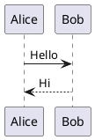

# Right-Stuff Editor Desktop ユーザーガイド

## はじめに

Right-Stuff Editor Desktop は、macOS 向けのローカルファースト編集アプリです。リッチテキストと Markdown を切り替えながら執筆し、ワークスペース内の Markdown ファイル、Apple Notes、AI チャット、ターミナルをひとつの画面で扱えます。

### 主な特徴

- **ハイブリッドエディター**: Lexical のリッチテキストと Markdown を相互変換
- **ワークスペース保存**: 指定フォルダーへ Markdown として保存。外部変更を検出
- **バージョン履歴**: 保存のたびに直前の内容を SQLite へ記録し、復元可能
- **リカバリ**: 未保存内容を 15 秒ごとにスナップショット。次回起動時に復元を提案
- **バックアップ**: ワークスペース全体を `.right-stuff/backups` へ定期保存
- **Apple Notes**: フォルダー・ノート一覧、本文の読み取りと直接更新
- **強化プレビュー**: GitHub Alerts、Mermaid、PlantUML、Archify HTML、KaTeX、シンタックスハイライト、拡大率変更
- **AI アシスタント**: OpenAI 互換 API、Ollama、LM Studio、Apple FM など
- **ターミナル**: macOS の PTY を wterm で表示
- **テーマ**: Light / Dark / System

## 動作環境

- macOS（Apple Silicon 推奨。パッケージは Universal：Intel / Apple Silicon 両対応）
- Node.js 18 以上（開発時）
- Apple Notes 連携には Notes への自動化権限
- ターミナルには `/usr/bin/python3` と `$SHELL`（既定 `/bin/zsh`）

## セットアップ

```bash
npm ci
npm run dev
```

別ターミナルで tinyjs を起動します。

```bash
tinyjs dev
```

パッケージ版を作る場合:

```bash
npm run package
open "dist/Right-Stuff Editor Desktop.app"
```

`npm run package` は Apple Events の利用目的を `Info.plist` に追加し、ad-hoc 署名します。Apple Notes 連携にはこの署名が必要です。

## 基本操作

1. 初回起動時にワークスペース（既定: `~/Documents/Right-Stuff`）が作成されます。
2. サイドバーで文書を作成・選択します。上部のフォルダー名からワークスペースを変更できます。
3. ツールバーでリッチテキスト / Markdown を切り替え、右側のプレビューで確認します。
4. `Ctrl/Cmd + S` で保存します。自動保存は既定で 30 秒間隔です。入力が止まったときにも、直近の保存から 10 秒以上経っていれば 2.5 秒後に保存します。
5. Notes ボタンから Apple Notes のフォルダーとノートを開けます。

## 編集

リッチテキストモードでは、ツールバーに加えてキーボードからブロックを組み立てられます。

### スラッシュメニュー

行頭で `/` を入力すると、挿入メニューが開きます。続けて文字を入力すると候補を絞り込めます。

- **基本**: 本文、見出し 1–6、箇条書き、番号付きリスト、チェックリスト、引用、コードブロック
- **挿入**: 表、水平線、リンク、画像、検索、検索と置換

`↑` `↓` で移動し、`Enter` で決定、`Esc` で閉じます。

### ブロック操作

| 操作 | ショートカット |
| --- | --- |
| 本文に戻す | `Ctrl/Cmd + Alt + 0` |
| 見出し 1–6 | `Ctrl/Cmd + Alt + 1–6` |
| 箇条書き | `Ctrl/Cmd + Shift + 8` |
| 番号付きリスト | `Ctrl/Cmd + Shift + 7` |
| チェックリスト | `Ctrl/Cmd + Alt + T` |
| 引用 | `Ctrl/Cmd + Shift + .` |
| コードブロック | `Ctrl/Cmd + Alt + C` |
| インラインコード | `Ctrl/Cmd + E` |
| ブロックを上下に移動 | `Ctrl/Cmd + Shift + ↑ / ↓` |
| リンクを挿入 | `Ctrl/Cmd + Alt + K` |
| 表を挿入 | `Ctrl/Cmd + Alt + A` |
| 水平線を挿入 | `Ctrl/Cmd + Alt + S` |
| 書式なしで貼り付け | `Ctrl/Cmd + Shift + V` |

チェックリストの項目は、左側のボックスをクリックして完了状態を切り替えられます。ツールバーの左揃え / 中央揃え / 右揃えも利用できます。

### 検索と置換

`Ctrl/Cmd + F` で検索バーを開きます。`Enter` で次の一致、`Shift + Enter` で前の一致へ移動します。`Ctrl/Cmd + Alt + F` または検索バーの `⇄` で置換欄を開き、1 件ずつ、またはすべてを置き換えられます。大文字と小文字の区別も切り替えられます。

一致箇所はすべて強調表示され、現在の一致は別色で表示されます。検索は段落内のインライン要素（太字、リンク、インラインコードなど）をまたいで一致します。段落、リスト項目、表のセル、改行をまたぐ一致は対象外です。

### Markdown 入力支援

`# `、`- `、`1. `、`> `、` ``` ` などの Markdown 記法を入力すると、対応するブロックへ自動変換されます。`- [ ] ` でチェックリストも作成できます。

### 表の Markdown 往復

リッチテキストで作成した表は、保存時に GFM テーブルとして Markdown へ書き出されます。Markdown を開き直すと再び表として読み込まれ、セル内の `|` は `\|` としてエスケープされます。セル内の改行は `<br>` として保持されます。

> 表のセル内にある Markdown のインライン書式（太字など）は、読み込み時にプレーンテキストへ変換されます。

## テンプレート

サイドバーの「テンプレート」またはコマンドパレットの「テンプレートから作成」から、文書の型を選んで新しい文書を作成できます。

- 左側の一覧はカテゴリで絞り込め、検索欄では本文まで含めて検索できます。`↑` `↓` で選択、`Enter` で作成、一覧のダブルクリックでも作成できます。
- 右側では Markdown プレビューとソースを切り替えられます。文書名を入力すると `{{title}}` に反映されます。
- 「白紙から作成」を選ぶと、テンプレートを使わずに空の文書を作成します。
- 設定 → テンプレートでは、自作テンプレートの追加・編集・削除・複製ができます。組み込みテンプレートは編集後に「初期化」で元へ戻せます。

本文中では次のプレースホルダを利用できます。

| プレースホルダ | 置換内容 | 例 |
| --- | --- | --- |
| `{{title}}` | 文書名 | 定例ミーティング |
| `{{date}}` | 作成日 | 2026-11-06 |
| `{{time}}` | 作成時刻 | 09:05 |
| `{{datetime}}` | 作成日時 | 2026-11-06T09:05 |
| `{{weekday}}` | 曜日 | 金曜日 |

旧形式の `YYYY-MM-DD`、`HH:MM`、`YYYY-MM-DDTHH:MM` も引き続き利用できます。

## 保存と履歴

- 文書はワークスペース内の `.md` ファイルとして保存されます。
- 保存は一時ファイル + `rename` の原子的な方式です。
- 自動保存は既定で 30 秒間隔です。入力が止まった場合も、直近の保存から 10 秒以上経っていれば 2.5 秒後に保存します。
- 外部でファイルが変更された場合、保存前に競合を検出します。
- 保存のたびに直前の内容が履歴へ追加されます。履歴モーダルからプレビュー・復元できます。
- 未保存のままアプリを閉じた場合、次回起動時にリカバリ内容の復元を確認します。

### バックアップ

Settings → バックアップで有効化します。JSON または Markdown 形式で、ワークスペース内の `.right-stuff/backups/<日時>-<形式>` に保存されます。Markdown 形式では文書ファイルと `workspace.json` を書き出します。

## Apple Notes

1. Notes ボタンを開き、アカウントとフォルダーを選択します。
2. ノートを選ぶと本文がエディターに読み込まれます。
3. 編集して保存すると、Notes の本文を更新します。
4. ロックされたノート、共有ノートなどは読み取り専用になります。
5. タイトルは Notes 側のノート名を使用します。

> 初回アクセス時に macOS が Notes の自動化許可を求めます。拒否した場合は「システム設定 → プライバシーとセキュリティ → オートメーション」で許可してください。

## プレビュー

| 機能 | 説明 |
| --- | --- |
| GitHub Alerts | `> [!NOTE]` などの色分け表示 |
| Mermaid | `mermaid` コードブロックを図として描画。SVG 保存とソースコピーに対応 |
| PlantUML | `plantuml` / `puml` コードブロックを PlantUML サーバー経由で描画。設定で URL を変更可能 |
| Archify | `archify` コードブロックにワークスペース内 HTML のパス、または HTML を直接埋め込み |
| KaTeX | `$...$` / `$$...$$` の数式 |
| シンタックスハイライト | コードブロックの言語別表示 |
| GFM | テーブル、チェックリスト、取り消し線、自動リンク |
| 拡大率 | プレビューヘッダーの − / % / ＋ で 50–200% に変更 |

### PlantUML



PlantUML は外部サーバー（既定: `https://www.plantuml.com/plantuml`）で描画します。図のソースがサーバーへ送信されるため、機密情報を含む図では Settings → 一般 → プレビューでローカルサーバー（例: `http://localhost:8080`）を指定するか、レンダリングを無効にしてください。

### Archify

Archify が生成した HTML をワークスペース内に保存し、そのパスを書きます。`./` `../` は現在の文書からの相対パス、それ以外はワークスペースからの相対パスです。

````markdown
```archify
.archify/system-architecture-20261106/diagram.html
```
````

HTML をそのままコードブロックへ貼り付けた場合も、sandbox 付き iframe で表示します。ワークスペース外のパスは読み込みません。

## AI アシスタント

Settings → AI でプロバイダー、エンドポイント、モデル、API キーを設定します。ゴーストテキスト補完、スラッシュコマンド、選択テキストのインライン変換、AI チャットを利用できます。

### Apple Foundation Models

macOS 26 以降の Apple Silicon で利用できます。アプリ内からは起動しないため、別ターミナルでブリッジを起動してください。

```bash
npm run applefm
```

Settings で **Apple FM** を選び、`http://127.0.0.1:8765/v1/chat/completions` を設定します。

## ターミナル

`Ctrl/Cmd + \`` で開きます。macOS の PTY 上で `$SHELL` を起動し、wterm で表示します。入力は中継プロセス経由、リサイズは PTY のウィンドウサイズ変更で反映されます。ヘッダーの「クリア」「再起動」で表示やシェルをリセットできます。

- 「文脈」ドロップダウンで、LLM に渡す対象（自動 / 文書全体 / 選択範囲のみ / 送らない）を選べます。自動は選択範囲があれば選択範囲を優先します。
- 「選択範囲を添えて質問」は、エディタで選択中のテキストを文脈として送ります。
- 「AI アクション」は、選択範囲（無ければ文書）に対して校正・書き直し・要約などを実行し、結果をそのまま挿入・置換できます。
- macOS のみ対応です。
- `/usr/bin/python3` が必要です（Command Line Tools に含まれます）。
- シェル設定によっては初回プロンプトまで時間がかかります。

## エクスポート

Markdown、HTML、JSON、TXT、DOCX、Ollama Modelfile へ書き出せます。PDF は印刷ダイアログ経由です。書き出し先はネイティブの保存ダイアログで選択します。

## キーボードショートカット

| 操作 | ショートカット |
| --- | --- |
| 保存 | `Ctrl/Cmd + S` |
| ファイルを開く | `Ctrl/Cmd + O` |
| 新規文書 | `Ctrl/Cmd + N` |
| プレビュー切替 | `Ctrl/Cmd + Shift + P` |
| サイドバー切替 | `Ctrl/Cmd + B` |
| AI チャット | `Ctrl/Cmd + Shift + C` |
| 設定 | `Ctrl/Cmd + ,` |
| エディターモード切替 | `Ctrl/Cmd + Shift + M` |
| ターミナル | `Ctrl/Cmd + \`` |
| Zen モード | `Ctrl/Cmd + Shift + Z` |
| タイプライターモード | `Ctrl/Cmd + Shift + T` |
| コマンドパレット / 検索 | `Ctrl/Cmd + K` |
| 文書内を検索 | `Ctrl/Cmd + F` |
| 検索と置換 | `Ctrl/Cmd + Alt + F` |
| ヘルプ | `Ctrl/Cmd + /` |

ショートカットは Settings から変更できます。

## 既知の制約

- Web 版は提供していません。
- 同期・共同編集はありません。
- mdv 連携、Agent Skill Manager は現在無効です。
- パッケージは Universal（Intel / Apple Silicon）です。ただし OS ごとの動作差（Notes 連携・ターミナル）は macOS のバージョンに依存します。
- Apple Notes のチェックリストや添付ファイルは、Notes の HTML 仕様により完全な往復編集ができない場合があります。

## トラブルシューティング

### Notes が読み込めない

システム設定 → プライバシーとセキュリティ → オートメーションで、Right-Stuff Editor Desktop に Notes の許可を与えてください。パッケージ版は ad-hoc 署名のため、再ビルド後に再度許可が必要になる場合があります。

### ターミナルが起動しない

`/usr/bin/python3 --version` を確認してください。`xcode-select --install` で Command Line Tools を導入すると利用できます。ターミナルを閉じてもシェルが残る場合は、アプリを再起動してください。

### 保存に失敗する

ワークスペースへの書き込み権限と空き容量を確認してください。外部変更の競合が表示された場合は、再読み込みするか上書きを選択してください。
