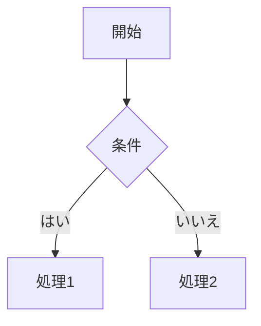

# Right-Stuff Editor Dash ユーザーガイド

## 目次

1. [はじめに](#はじめに)
2. [動作環境](#動作環境)
3. [セットアップ](#セットアップ)
4. [基本操作](#基本操作)
5. [エディターの機能](#エディターの機能)
6. [強化プレビュー](#強化プレビュー)
7. [ローカルファイル連携](#ローカルファイル連携)
8. [mdv連携](#mdv連携)
9. [AIアシスタント](#aiアシスタント)
10. [スキルマネージャー (ASM)](#スキルマネージャー-asm)
11. [ターミナル](#ターミナル)
12. [エクスポート機能](#エクスポート機能)
13. [設定](#設定)
14. [キーボードショートカット](#キーボードショートカット)
15. [トラブルシューティング](#トラブルシューティング)

---

## はじめに

Right-Stuff Editor Dashは、Markdownとリッチテキストの両方に対応した万能エディターです。AIアシスタントとの連携により、執筆支援を受けることができます。

### 主な特徴

- **ハイブリッドエディター**: リッチテキストとMarkdownを切り替え可能
- **リアルタイムプレビュー**: GitHub Alerts・Mermaid・シンタックスハイライト対応の強化プレビュー
- **ローカルファイル連携**: 開いたファイルへの上書き保存と未保存の離脱検知
- **mdv連携**: Electron版でmdvによる高品質プレビュー（別窓）
- **AIアシスタント**: Ollama、AnythingLLM、OpenAI、LM Studio、Foundry Local等のLLMと接続可能
- **スキルマネージャー**: ASM (agent-skill-manager) によるAIエージェントスキル管理（Electron専用）
- **自動保存**: IndexedDBによる自動保存（30秒間隔）
- **ターミナル**: 内蔵ターミナルパネル。ブラウザではモックターミナル、Electron ではパネル内に実際の OS シェル（wterm + node-pty）を実行
- **テーマ切替**: Light / Dark / System から選択可能

---

## 動作環境

### 推奨環境

- **ブラウザ**: Chrome 90+, Firefox 88+, Safari 14+, Edge 90+
- **Node.js**: 18.x 以上
- **OS**: macOS, Windows, Linux

### LLM接続に必要な環境

AIアシスタントを使用する場合、以下のいずれかの環境が必要です：

- **Ollama**: ローカルでLLMを実行（推奨）
  - ダウンロード: https://ollama.ai
  - デフォルトポート: 11434
- **AnythingLLM**: ローカルLLMプロキシ
  - デフォルトポート: 3001
- **OpenAI**: クラウドAPI
  - APIキーが必要

---

## セットアップ

### 1. リポジトリのクローン

```bash
git clone https://github.com/watanabe3tipapa/right-stuff-editor-dash.git
cd right-stuff-editor-dash
```

### 2. 依存関係のインストール

```bash
cd packages/editor
npm install
```

### 3. 開発サーバーの起動

```bash
npm run dev
```

ブラウザで http://localhost:3000 にアクセスするとエディターが表示されます。

### 4. Electronとして起動（オプション）

```bash
npm run electron:dev
```

---

## 基本操作

### ドキュメントの作成と保存

1. **新規作成**: `Ctrl+N` またはツールバーの「新規」ボタン
2. **保存**: `Ctrl+S` で手動保存
3. **自動保存**: 30秒ごとに自動保存（設定で無効化可能）

### ドキュメントの検索と並び替え

サイドバーの上部で、文書を検索または並び替えできます。

- **検索**: タイトルと本文の両方を対象に、入力と同時に絞り込みます
- **並び替え**: 更新日時・作成日時・タイトルで昇順/降順を選択できます
- **複製**: 文書にカーソルを合わせて表示される複製アイコンで、同じ内容の文書を「(copy)」として作成します

### ファイル操作

1. **開く**: `Ctrl+O` でMarkdown/TXTファイルを選択
2. **名前を付けて保存**: ツールバーの保存アイコンをクリック
3. **同じファイルへ上書き保存**: 開いたローカルファイルを編集後、ツールバーの保存アイコンでそのまま上書き（フッターにファイル名が表示されます）
4. **エクスポート**: ツールバーのエクスポートメニューから形式を選択

> ローカルファイルを開いて編集している状態で保存すると、同じファイルへ上書きされます。未保存のまま閉じようとすると離脱確認ダイアログが表示されます。

### viewモードの切り替え

ツールバーのアイコンで切り替え：

- 📝 エディターのみ
- ⬜⬜ 分割表示（推奨）
- 👁 プレビューのみ

### エディターモードの切り替え

- **Rich Text**: ビジュアルなリッチテキスト編集
- **Markdown**: raw Markdown編集

切り替え: `Ctrl+Shift+M`

---

## エディターの機能

### リッチテキストモード

- **太字**: `Ctrl+B` またはツールバーボタン
- **斜体**: `Ctrl+I` またはツールバーボタン
- **下線**: `Ctrl+U` / **取り消し線**: ツールバーボタン
- **文字色 / 文字の背景色**: ツールバーのカラーパレットで選択（選択中は「×」でリセット）
- **フォントサイズ**: ツールバーのサイズプルダウン（12〜32px）で変更
- **Undo / Redo**: ツールバーの ↶ / ↷ ボタン（`Ctrl+Z` / `Ctrl+Y`・`Ctrl+Shift+Z`）
- **コード**: インラインコード、コードブロック対応
- **リスト**: 番号付き、箇条書きリスト
- **見出し**: H1〜H6対応
- **引用 / 水平線**: ツールバーボタンまたは `---`、`***` のMarkdown入力
- **リンク**: 🔗 ボタンからURLを指定して挿入（`` 構文にも対応）
- **画像**: 🖼 ボタンからURL・代替テキスト指定、または **ドラッグ＆ドロップ / クリップボードからの貼り付け**（画像ファイルはData URLとして埋め込み）
- **表**: ▦ ボタンから行数・列数を指定して挿入

### Markdownモード

通常のMarkdown記法が使用可能：

````markdown
# 見出し1
## 見出し2

**太字** *斜体* ~~取り消し線~~

- 箇条書き1
- 箇条書き2

1. 番号付き1
2. 番号付き2

[リンクテキスト](URL)


```
コードブロック
```
````

### プレビュー

右側のプレビューパネルでMarkdownがHTMLとしてレンダリングされます。リアルタイムで更新されるため、執筆しながら確認できます。

強化されたプレビュー機能については [強化プレビュー](#強化プレビュー) を参照してください。

---

## 強化プレビュー

MarkdownプレビューはGitHubスタイルの拡張記法と図表に対応しています。

### GitHub Alerts（アラート）

ブロック引用の先頭にマーカーを置くと、色分けされたアラートとして表示されます。

```markdown
> [!NOTE]
> 補足情報をここに書きます。

> [!WARNING]
> 注意を促す内容です。

> [!TIP]
> 役立つヒントです。

> [!IMPORTANT]
> 重要な内容です。

> [!CAUTION]
> 危険性に関する内容です。
```

| マーカー | 表示色 |
|---------|--------|
| `[!NOTE]` | 青 |
| `[!TIP]` | 緑 |
| `[!IMPORTANT]` | 紫 |
| `[!WARNING]` | 黄 |
| `[!CAUTION]` | 赤 |

### Mermaid図表

`mermaid` 言語のコードブロックを書くと、フローチャートなどのダイアグラムとして描画されます。テーマ（Light/Dark）に連動します。

````markdown

````

### シンタックスハイライト

言語を指定したコードブロックは、言語ごとに色分け表示されます。

````markdown
```javascript
const greeting = "Hello, World!";
console.log(greeting);
```
````

---

## ローカルファイル連携

開いたローカルファイル（Markdown / TXT）を編集して、同じファイルへ上書き保存できます。

### 開く

1. ツールバーの **開く**（または `Ctrl+O`）でMarkdown / TXTファイルを選択
2. エディタに内容が読み込まれ、フッターにファイル名が表示されます

### 保存

- **上書き保存**: 開いたローカルファイルの状態でツールバーの保存アイコンを押すと、そのファイルへ上書きされます
- **名前を付けて保存**: エクスポートメニューや新規で保存する際は保存先を選択できます

### 未保存の離脱検知

未保存のままタブやウィンドウを閉じようとすると、離脱確認ダイアログが表示されます。

### Web版とElectron版の違い

| 項目 | Web版 | Electron版 |
|------|-------|-----------|
| ファイル選択 | File System Access API（Chrome/Edge） | ネイティブダイアログ |
| 上書き保存 | 対応（再許可が必要な場合あり） | 対応（ダイアログ経由） |
| 利用可否 | Chrome/Edge系で利用 | macOS / Windows / Linux |

---

## mdv連携

Electronデスクトップ版では、ローカルで動作する **mdv** ツールを使って、開いている文書の高品質プレビューを別ウィンドウで表示できます。

### 前提条件

`mdv` がローカルにインストールされている必要があります。未インストールの場合はフッターに案内が表示されます。

### 使い方

1. ローカルファイルを開く（または保存先を確定する）
2. ツールバーの **Open in mdv** ボタンをクリック
3. mdvが起動し、プレビューが別ウィンドウで開きます
4. mdvはローカルファイルを監視するため、エディタでの保存がプレビューに自動反映されます

### 制限

- mdv連携は **Electron版のみ** 利用可能です。ブラウザ版では内蔵の強化プレビューをご利用ください。
- ブラウザ版で「Open in mdv」を押した場合は、フッターに利用不可の案内が表示されます。

---

## AIアシスタント

AIはチャットだけでなく、編集中のテキストそのものにも働きかけます。

### ゴーストテキスト補完

Settings →「AI」→「AI 補完（ゴーストテキスト）」を有効にすると、入力を止めたあとに AI が続きを灰色で候補表示します。

- **Tab**: 候補を採用して本文に挿入
- **Esc**: 候補を破棄
- 待機時間（既定 1000ms）と最大候補トークン数は Settings で調整できます

### スラッシュコマンド

エディタの行頭（または単語の直後）で `/` を入力すると挿入メニューが表示されます。キーワードで絞り込み、選択して Enter またはクリックで挿入します。

- 見出し（H1〜H3）、引用、箇条書き、番号付きリスト、チェックリスト
- コードブロック、表、水平線

### インラインAI変換

テキストを選択すると「✨ AI」ボタンが出現します。クリックするとアクション一覧が開き、選択したテキストを LLM で変換して置き換えます。

| アクション | 内容 |
| --- | --- |
| 校正 | 誤字脱字・文法・表記を修正 |
| 書き直し | 表現を改善 |
| シンプルに | 簡潔に分かりやすく |
| 詳しく | 内容を拡充 |
| 要約 | 3文以内にまとめる |
| 英訳 / 和訳 | 翻訳 |
| フォーマルに / カジュアルに | トーン変更 |
| 箇条書きに | リスト形式へ変換 |

### 文体プロファイルとエンティティメモリ

Settings →「文体・メモリ」で管理します。

- **文体プロファイル**: 名前とシステムプロンプトを保存し、有効なプロファイルを切り替えます。有効なプロファイルは補完・アクション・チャットのすべてのAIリクエストに適用されます。
- **エンティティメモリ**: よく使う固有名詞（人物・プロジェクト・用語・場所）とメモを登録します。AIが一貫した表記で回答するようになります。

### チャットパネルの開閉

`Ctrl+Shift+C` でAIチャットパネルを開閉します。

### 文書コンテキスト（現在の文書を含める）

チャットパネルの入力欄の上に「現在の文書を含める」トグルがあります。有効（既定）の場合、編集中の文書（Markdown）がリクエストに `system` メッセージとして添付されます。プロンプトテンプレートの「Summarize」「Continue」「Improve」「Examples」は、この文書が渡って初めて機能します。

- 添付される文字数が表示されます。6,000文字を超える場合は先頭6,000文字のみを送り、末尾に省略の注記が付きます
- トグル状態はブラウザに永続化されます
- 文書内容を外部に送らない場合は、トグルをOFFにしてください

### カスタム指示（System Prompt）

Settingsの「System Prompt」に文章を入力すると、すべてのリクエストの `system` メッセージの先頭に付与されます。入力内容はブラウザに永続化されます。空欄の場合はLLM側の既定の指示が使われます。

### チャット応答のMarkdown表示

AIの応答はMarkdownとして整形されて表示されます。見出し・箇条書き・表・引用・太字・斜体・リンク・画像、およびシンタックスハイライト付きのコードブロックに対応しています。応答に含まれる生のHTMLやスクリプトは、安全のため除去・無害化されます。

### プロバイダーの設定

1. `Ctrl+,` で設定を開く
2. 「AI」タブの「LLM Provider」から選択：
   - **Ollama**: ローカルLLM（推奨）
   - **AnythingLLM**: ローカルプロキシ
   - **OpenAI** / **Anthropic** / **Gemini** / **Groq** / **DeepSeek** / **Mistral** / **Together** / **OpenRouter** / **Perplexity** / **xAI** / **Hugging Face**: クラウドAPI（OpenAI互換）
   - **LM Studio** / **Foundry Local** / **Unsloth**: ローカルLLM
   - **Apple FM**: macOSのオンデバイスモデル（Apple Intelligence）
   - **Custom**: 任意のOpenAI互換API
3. エンドポイントとモデルを設定（多くはモデル一覧を自動取得します）

### Unslothの場合

Unslothは量子化・推論ツール。ローカルでモデルを公開する際、OpenAI互換のAPIエンドポイントを提供します。

1. Unslothをインストールして起動（https://unsloth.ai/download）
2. モデルを選択して読み込む
3. Settingsで **Unsloth** を選択（デフォルト `http://127.0.0.1:8888/v1/chat/completions`）
4. Unslothが発行するAPIキー（`sk-unsloth-...`）を入力
5. モデル一覧が自動取得されます

### Apple FMの場合

macOSに内蔵されたオンデバイスモデル（Apple Intelligence）を利用します。データは端末外に出ません。

**必要条件**

| 項目 | 要件 |
|------|------|
| OS | macOS 26 以降 |
| 端末 | Apple Silicon（M系） |
| Apple Intelligence | 設定 > Apple Intelligence で有効 |
| ビルド | Xcode 26 / Command Line Tools（FoundationModels.framework を含むSDK） |

**手順**

1. ブリッジを起動します。

   ```bash
   cd packages/editor
   npm run applefm      # ビルドして起動
   npm run applefm:build  # ビルドのみ
   ```

   ポートは引数または環境変数で変更できます（`./applefm/build/apple-fm-server --port 9000`、`APPLEFM_PORT=9000 npm run applefm`）。

2. Settingsで **Apple FM** を選択します（デフォルト `http://127.0.0.1:8765/v1/chat/completions`）。
3. 「状態を確認」でブリッジの稼働とモデル状態を確認します。

| 表示 | 意味 |
|------|------|
| ✓ Running | 利用可能 |
| ! appleIntelligenceNotEnabled | 設定 > Apple Intelligence で有効にしてください |
| ! modelNotReady | モデルのダウンロードが完了していません |
| ! deviceNotEligible | Apple Silicon が必要です |
| 接続できません | ブリッジが起動していません（`npm run applefm`） |

#### 起動方法の違い

| 版 | ブリッジの起動 | 設定画面の表示 |
|----|----------------|----------------|
| **Electron版** | Settings内の「サーバー起動」「サーバー停止」ボタン（アプリ終了時に自動停止） | Status に「✓ Running」と **プロセスID** が表示 |
| **ブラウザ版（Web）** | 別ターミナルで `npm run applefm` を実行 | Status に「✓ Running」のみ。「サーバー起動」ボタンは出ず、「ブラウザ版では `npm run applefm` でサーバーを起動してください。」という案内を表示 |

ブラウザ版でもブリッジは `Access-Control-Allow-Origin: *` を返すため、`http://localhost:3000` など別のオリジンからそのまま呼び出せます。プリフライト（OPTIONS）は 204 を返します。

> ブリッジは `127.0.0.1` にのみバインドします。オンデバイスモデルのコンテキストは小さいため、Max Tokensは1024程度を推奨します（超過分は内部でクランプされます）。

### Ollamaの場合

1. Ollamaをインストール: https://ollama.ai
2. モデルをDL: `ollama pull llama3.2`
3. 設定でモデルを選択（自動検出されます）

### アシスタントメッセージをエディターにコピー

各 Assistant メッセージの右上にあるコピーボタン（クリップボードアイコン）をクリックすると、メッセージ内容をエディターに追記できます。

- **リッチテキストモード**: Lexical エディタの最終行に新しい段落として挿入
- **Markdownモード**: エディタのテキスト末尾に改行付きで追記

### プロンプトテンプレート

チャット入力欄の右にあるテンプレートボタンからを選択：

- 「Continue writing」- 続きを書く
- 「Summarize」- 要約する
- 「Improve」- 文体改善
- 「Translate to HTML」- HTMLに変換
- 「Add examples」- 例を追加

---

## スキルマネージャー (ASM)

AIエージェントスキルを一元管理できるパネルです。agent-skill-manager (ASM) をバックエンドとして、スキルの検索・インストール・管理が行えます。

> **注意**: スキルマネージャーは Electron デスクトップアプリケーションでのみ利用可能です。ブラウザ版では🧩アイコンをクリックすると「Not Available in Browser」と表示されます。

### パネルの開閉

ツールバーの🧩アイコンをクリックするか、`Ctrl+Shift+A` で開閉します。

### ビューモード

| モード | 説明 |
|-------|------|
| **Catalog** | レジストリから全スキルをブラウズ |
| **Installed** | 現在インストール済みのスキルのみ表示 |

### スキルの検索

1. 検索バーにキーワードを入力
2. Enter または Search ボタンをクリック
3. マッチするスキルが一覧表示されます

### スキルのインストール/アンインストール

- **インストール**: スキルカードの **Install** ボタンをクリック
- **アンインストール**: インストール済みスキルの **Uninstall** ボタンをクリック

### スキル詳細

スキルカードをクリックするとモーダルが開き、以下の詳細情報が表示されます：

- バージョン
- 作者
- 説明
- タグ
- インストール状態

### 前提条件

ASM CLI がインストールされている必要があります：

```bash
npm install -g agent-skill-manager
```

詳細は [agent-skill-manager](https://www.npmjs.com/package/agent-skill-manager) を参照してください。

---

## ターミナル

`Ctrl+\`` またはツールバーのターミナルアイコンで開閉します。

### Webブラウザ版（モックターミナル）

内蔵のモックターミナルで以下のコマンドが使用可能です：

| コマンド | 説明 |
|---------|------|
| `help` | コマンド一覧を表示 |
| `echo <message>` | メッセージを表示 |
| `date` | 現在日時を表示 |
| `version` | バージョン情報を表示 |
| `whoami` | ユーザー名を表示 |
| `ls` | ディレクトリ一覧（モック） |
| `pwd` | カレントディレクトリ（モック） |
| `clear` | 画面をクリア |
| `main`, `neo`, `beos`, `osx`, `qe`, `te` | 関連ツールをブラウザで開く |
| `open <url>` | 指定したURLをブラウザで開く |

### Electron版（アプリ内ターミナル）

Electron で実行すると、ターミナルパネル内に実際の OS シェルが起動します。描画は `wterm`、プロセス生成は `node-pty` を使います。

- **シェルの選択**: `process.env.SHELL` を使い、未設定の場合は `/bin/bash` を起動します
- **作業ディレクトリ**: 編集中のファイルがあればそのファイルのディレクトリ、なければホームディレクトリで起動します。起動後に `cd` で移動してもそのまま維持されます
- **端末種別の環境変数**: `TERM=xterm-256color`。初期サイズは 80x24 で、コンテナの大きさに合わせて桁数と行数を自動調整します
- **パネルの開閉**: パネルを開くとシェルが起動し、閉じるとシェルも終了します。シェルで `exit` を実行すると終了コード付きのメッセージが表示されます。再度開くと最初の状態から起動します
- **操作**: 入力欄へ直接タイプして Enter で実行します。コマンド履歴は `↑` / `↓`、補完は `Tab`、中断は `Ctrl+C`（シェル側の機能です）

Web版では PTY を利用できないため、前述のモックターミナルに自動的にフォールバックします。

---

## エクスポート機能

ツールバーのエクスポートメニューから選択：

### Markdown (.md)

元のMarkdown形式で保存

### HTML (.html)

HTMLに変換して保存。スタイリング付き

### PDF (.pdf)

ブラウザの印刷機能を使ってPDFとして保存

### JSON (.json)

```json
{
  "content": "ドキュメント内容",
  "exportedAt": "2026-04-07T12:00:00.000Z"
}
```

---

## 設定

`Ctrl+,` で設定パネルを開く。設定は「一般 / AI / 文体・メモリ / Gist」の4タブ構成です。

### 一般タブ

- **Theme**: Light / Dark（既定）/ System から選択

### AIタブ

- Provider選択（18種）
- Endpoint設定
- Model選択（多くは自動取得）
- API Key（クラウドAPIの場合）
- Temperature / Max Tokens / System Prompt
- AI 補完（ゴーストテキスト）の有効化・待機時間・候補長

### 文体・メモリタブ

- **文体プロファイル**: 名前とシステムプロンプトの追加・編集・削除、有効プロファイルの切替
- **エンティティメモリ**: 固有名詞（種類・メモ付き）の追加・編集・削除

### Gistタブ

- GitHub Personal Access Token（PAT）の入力・検証・切断

### 自動保存

- 有効/無効
- 保存間隔（デフォルト30秒）

---

## キーボードショートカット

| アクション | ショートカット |
|-----------|--------------|
| 保存 | `Ctrl+S` |
| ファイルを開く | `Ctrl+O` |
| 新規ドキュメント | `Ctrl+N` |
| プレビュー切り替え | `Ctrl+Shift+P` |
| サイドバー切り替え | `Ctrl+B` |
| AIチャット切り替え | `Ctrl+Shift+C` |
| スキルマネージャー切り替え | `Ctrl+Shift+A` |
| 設定を開く | `Ctrl+,` |
| エディターモード切り替え | `Ctrl+Shift+M` |
| Zen モード切り替え | `Ctrl+Shift+Z` |
| タイプライターモード切り替え | `Ctrl+Shift+T` |
| スラッシュコマンド | 行頭で `/` を入力 |
| インラインAI | テキストを選択して「✨ AI」 |
| AI補完の採用 / 破棄 | `Tab` / `Esc` |
| ターミナル切り替え | `Ctrl+\`` |
| ショートカット一覧・ヘルプ | `Ctrl+/` |

---

## トラブルシューティング

### 開発サーバーが起動しない

```bash
# ポートが使用中の場合
lsof -i :3000
kill <PID>

# node_modulesを再インストール
rm -rf node_modules
npm install
```

### LLMに接続できない

1. Ollamaが起動しているか確認: `ollama list`
2. エンドポイントを確認: http://localhost:11434
3. ファイアウォール設定を確認

### 自動保存が動かない

1. ブラウザがIndexedDBをサポートしているか確認
2. ブラウザのストレージ容量を確認
3. 設定で自動保存が有効か確認

### アプリ内ターミナルが起動しない

1. Electron版で実行しているか確認（ブラウザ版はモックターミナルが表示されます）
2. macOS ではヘルパーに実行権限があるか確認:

```bash
chmod +x node_modules/node-pty/prebuilds/darwin-arm64/spawn-helper
```

3. `node-pty` が Electron の ABI 用にビルドされているか確認（再インストール後は `electron-rebuild` が必要な場合があります）
4. `npm run electron:dev` で起動し、メインプロセスと DevTools の Console にエラーが出ていないか確認

### ビルドエラー

```bash
# TypeScriptエラーの確認
npm run build

# エラーに応じて Typescript設定を確認
```

---

## ライセンス

[MIT License](./LICENSE)

---

## フィードバック

バグ報告や機能リクエストは、GitHubのIssueにお寄せください。